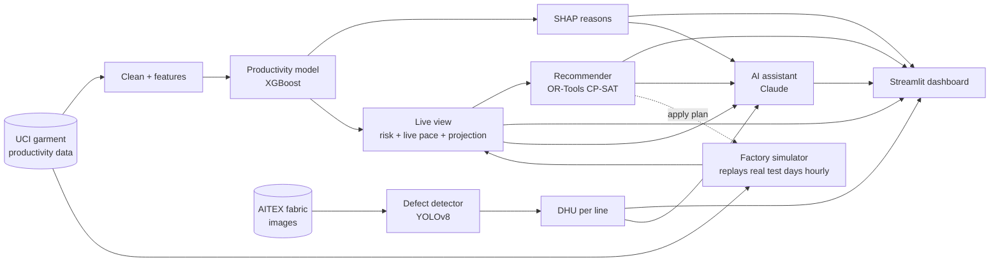
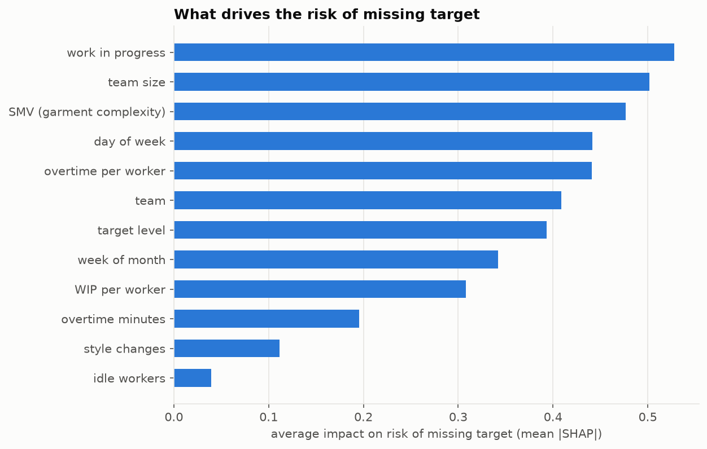
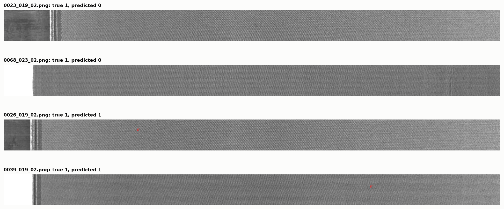

# 🧵 LoomIQ: Garment Factory Intelligence Platform

> Warns a garment factory manager which production lines will miss today's target and why, recommends how to fix them, catches fabric defects, and puts it all on one live dashboard with an AI assistant.


🔗 **Live demo:** _coming soon_  
🎥 **Demo video:** _coming soon_

---

## 📖 The Problem

A production manager in a large apparel factory runs 20+ lines at once. Every day the same questions come up:

- *Which lines will fall behind today?*
- *Why are they falling behind?*
- *What can I do about it, right now?*
- *Is the fabric coming out with defects?*

Usually the answers arrive at the end of the shift, when targets are already missed and defective garments are already sewn. That means lost output, late deliveries and costly returns.

## 💡 The Solution: a manager's morning with LoomIQ

| Time | What LoomIQ does | Module |
|---|---|---|
| **8:00** | Flags the lines likely to miss today's target, with the reasons (e.g. "complex garment, small team") | **1. Predict** (XGBoost + SHAP) |
| **8:05** | Suggests a fix: "move 1 operator from Finishing 7 to Finishing 9, add 60 min overtime on Sewing 8" | **2. Recommend** (OR-Tools) |
| **During the shift** | Tracks every line hour by hour; the projection moves from the model's forecast to the line's real pace | **4. Live Dashboard** (Streamlit) |
| **Inspection** | Scans fabric images, boxes each defect, and keeps a running DHU per line | **3. Detect** (YOLOv8) |
| **Any time** | Answers "Why is Sewing 7 behind?" in plain language, from the live data | **AI Assistant** (Claude) |

## 🏗️ Architecture



## 🖥️ The Dashboard

| Page | What you can do |
|---|---|
| **🧵 Home** | All lines at a glance: status (✅ on track / ⚠️ at risk / 🔴 behind), projected output vs target, model risk score, today's DHU, latest events |
| **📈 Line Monitor** | One line hour by hour: output vs target pace, projection, the model's SHAP reasons, breakdowns and style changes |
| **🛠️ Recommendations** | The optimal plan for at-risk lines, with adjustable limits, and **"Apply plan"** to change the simulated day and watch lines recover |
| **🔍 Defect Scanner** | Upload fabric images from a line, see each defect boxed, and track DHU per line |
| **🤖 AI Assistant** | Ask questions in plain English. Works with Claude (API key) or in an offline rule-based mode |

Move through the shift with the sidebar clock: **▶ Next hour**, **⏩ End of shift**, **🔄 New day**.

## 🛠️ Tech Stack

- **Language:** Python 3.11
- **Data:** pandas, NumPy
- **Machine learning:** scikit-learn, XGBoost
- **Explainability:** SHAP
- **Optimization:** Google OR-Tools (CP-SAT)
- **Computer vision:** PyTorch, Ultralytics YOLOv8
- **Dashboard:** Streamlit, Plotly
- **AI assistant:** Anthropic Claude API (`claude-opus-5-5`)
- **Testing:** pytest

## 📊 Datasets

| Dataset | Used for | Type |
|---|---|---|
| [Productivity Prediction of Garment Employees (UCI)](https://archive.ics.uci.edu/dataset/597/productivity+prediction+of+garment+employees) | Prediction, recommendations, simulator | ✅ Real factory data (1,197 team-days, 2015) |
| [AITEX Fabric Image Database](https://www.aitex.es/afid/) (Silvestre-Blanes et al., AUTEX Research Journal, 2019) | Defect detection | ✅ Real fabric images (245 images) |
| Factory simulator | Live dashboard | ⚙️ Simulated: replays **real test-week days** hour by hour |

See [`docs/DATASETS.md`](docs/DATASETS.md) for download steps and where to place each dataset. No data is stored in this repository.

> **What is real and what is simulated:** every reported metric comes from real data. Only the hour-by-hour stream on the dashboard is simulated, and it is built from real days the model never saw in training.

## 📁 Project Structure

```
LoomIQ/
├── app/                     # Streamlit dashboard
│   ├── Home.py              #   factory overview
│   └── pages/               #   Line Monitor, Recommendations, Defect Scanner, AI Assistant
├── src/loomiq/              # Core package (pip install -e .)
│   ├── data/                #   load + clean the UCI data
│   ├── features/            #   target and model features
│   ├── models/              #   train, predict, SHAP explanations
│   ├── optimization/        #   OR-Tools recommender
│   ├── simulation/          #   hour-by-hour factory simulator
│   ├── vision/              #   AITEX tiles, YOLOv8 training, detection, DHU
│   ├── assistant/           #   Claude assistant + offline mode
│   ├── dashboard/           #   live view, charts, session state
│   └── utils/               #   logging, chart style
├── notebooks/               # 01 data → 02 EDA → 03 features → 04 modelling → 04b recommendations → 05 defects
├── configs/config.yaml      # every setting in one place
├── scripts/                 # train_all.py, run_simulator.py
├── tests/                   # pytest suite
├── reports/                 # metrics (JSON) and figures
├── docs/DATASETS.md         # dataset download guide
├── data/, models/           # created locally, not tracked by git
```

## 🚀 Setup & Run Locally

**1. Create and activate a virtual environment (Python 3.11)**
```bash
python -m venv .venv
# Windows
.venv\Scripts\activate
# macOS / Linux
source .venv/bin/activate
```

**2. Install**
```bash
pip install -r requirements.txt
pip install -e .
```

**3. Download the UCI dataset** into `data/raw/` ([`docs/DATASETS.md`](docs/DATASETS.md)). AITEX is optional: everything except the Defect Scanner works without it.

**4. Train**
```bash
python scripts/train_all.py               # everything (defect model is skipped if AITEX is missing)
python scripts/train_all.py --skip-vision  # productivity model only (about 1 minute)
```

**5. (Optional) AI assistant:** copy `.env.example` to `.env` and add `ANTHROPIC_API_KEY=...`. Without a key the assistant runs in offline mode.

**6. Run the dashboard**
```bash
streamlit run app/Home.py
```

**Tests:** `pytest`. Shortcuts with `make`: `make install`, `make train`, `make app`, `make test`, `make simulate`.

## 📈 Results

### Module 1: Productivity prediction

XGBoost, tested on the **last 2 weeks of data** (never seen during training). Scores are for the class that matters: **lines that miss their target**.

| Metric | Baseline (always "met") | XGBoost |
|---|---|---|
| F1 (missed target) | 0.00 | **0.50** (finishing 0.61, sewing 0.26) |
| Recall (missed target) | 0% | **60%** of real misses caught |
| Precision (missed target) | n/a | **43%** of warnings correct (vs 27% by chance) |
| ROC-AUC | 0.50 | **0.72** |
| Accuracy | 73% | 68% |

- Incentive is deliberately **excluded**: it looks like a reward paid *after* good output, so using it would leak the answer.
- Sewing is weak because a **new garment style with lowered targets** started in the test weeks, a situation the model had never seen. See [notebook 04](notebooks/04_modeling.ipynb) for the full analysis.
- The risk score works as a **ranking**: the share of lines that really missed rises from 11% in the lowest-risk band to 49% in the highest.



### Module 2: Recommendations

OR-Tools CP-SAT chooses **operator moves** (same department only) and **extra overtime** to minimise the pieces each at-risk line is expected to fall short. Lines that lend operators must still meet their own target.

| Scenario (test weeks) | Result |
|---|---|
| One day (4 March 2015) | expected shortfall cut from **1,450 to 44 pieces** (97%) |
| All 12 test days | **22,127 to 2,539 pieces** short (89% recovered) |
| Solver | proven optimal plan on every test day |

- The solver found a real factory pattern on its own: **finishing** lines rebalance operators, while **sewing** lines need overtime, because sewing teams that are on track have no spare capacity to lend.
- Plans are **suggestions for a supervisor to confirm**: they are based on predicted risk, and about 43% of "will miss" warnings are correct. See [notebook 04b](notebooks/04b_recommendations.ipynb).

### Module 3: Defect detection

YOLOv8 nano (pretrained on COCO), fine-tuned on 256 × 256 tiles cut from AITEX (one "defect" class), split **by source image**, and evaluated on **36 held-out test panels**. The confidence threshold (0.15) was chosen on the validation panels.

| Metric | Score |
|---|---|
| Defective panels caught | **11 of 15 (73%)** |
| Clean panels wrongly flagged | **0 of 21 (0%)** |
| Panel accuracy | **89%** |
| DHU: true vs predicted | **47.2 vs 52.8** |
| Tile precision / recall / mAP@50 | 0.71 / 0.36 / 0.35 |

- Small, high-contrast defects are caught well (fuzzyballs 5 of 6, every broken pick and broken end); faint **creases** and **broken yarn** are the weak spot.
- Tile recall looks low because a long defect spans many tiles, while a panel counts as caught if any part of it is found.
- The test set holds only 15 defective panels, so each one moves the percentage by about 7 points. See [notebook 05](notebooks/05_defect_detection.ipynb).



## 💼 Business Impact

What the backtest on the 12 held-out days suggests, and what it doesn't:

- **Earlier warnings:** at 8 am, the model catches 60% of the lines that will miss, hours before the shift ends.
- **Clear reasons:** SHAP shows *why* a line is at risk (garment complexity, team size, WIP), so supervisors know where to look.
- **Actionable fixes:** if the warnings were right, the recommended plans would recover **about 89% of the expected shortfall**, mostly with operator moves in finishing and overtime in sewing.
- **Automatic quality checks:** on held-out fabric, the detector flags 73% of defective panels with no false alarms, and estimates DHU within about 6 per 100 units, shown per line beside output so a manager doesn't push a line harder while its quality is slipping.
- **Honest limits:** only 43% of early warnings are right, so plans should be confirmed by a supervisor; and the data is one factory over 10 weeks in 2015.

## 📚 Key Apparel Terms

| Term | Meaning |
|---|---|
| **SMV** (Standard Minute Value) | The standard time needed to complete one garment operation. |
| **Line efficiency / productivity** | Actual output compared to the standard output: pieces × SMV / minutes worked. |
| **WIP** (Work in Progress) | Unfinished pieces waiting at a line. |
| **DHU** (Defects per Hundred Units) | Number of defects found per 100 units checked. Lower is better. |
| **OTD** (On-Time Delivery) | Percentage of orders delivered to the buyer on time. |

## 🔮 Future Work

- **Quality-aware recommendations:** feed each line's DHU into the optimizer, so it avoids loading overtime onto lines whose quality is dropping, and counts only *good* pieces.
- **Better sewing predictions:** add "target vs the team's usual target" and "days since a new style started" features.
- **Real factory data:** hourly line data (e.g. from an MES) instead of daily records, and a calibrated risk probability.
- **Defect types:** classify defect types once more labelled images are available.
- **Edge deployment** of the defect detector on inspection-table cameras, and mobile alerts for supervisors.
- **Demand forecasting** to support production planning.

## 👤 Author

**Your Name**  
📧 your.email@example.com  
🔗 [LinkedIn](https://linkedin.com/in/your-profile) · [GitHub](https://github.com/your-username)

---

⭐ If you find this project useful, consider giving it a star!
