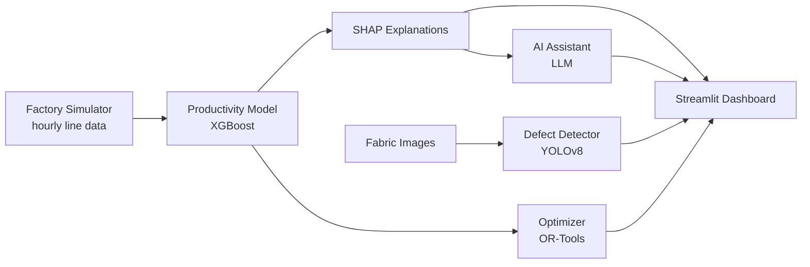

# 🧵 LoomIQ: Garment Factory Intelligence Platform

> An AI-powered platform that predicts production line performance, recommends fixes, detects fabric defects, and shows it all on a live factory dashboard.


🔗 **Live demo:** _coming soon_  
🎥 **Demo video:** _coming soon_

---

## 📖 The Problem

In a large garment factory, a manager runs many sewing lines at once. Every day, the same questions come up:

- *Which lines will fall behind today?*
- *Why are they falling behind?*
- *Is the fabric coming out with defects?*

Usually, the manager only finds out at the end of the day, when targets are already missed and defective garments are already made. That means lost output, late deliveries, and costly returns.

## 💡 The Solution

LoomIQ acts as a smart assistant for the factory manager. It warns early, explains why, suggests a fix, and catches defects before they reach the customer.

| Module | What it does |
|---|---|
| **1. Predict** | Learns from past factory data to predict whether each line will hit its target, and explains the main reasons using SHAP. |
| **2. Recommend** | When a line is at risk, suggests the best fix, such as moving operators or adjusting overtime, using optimization. |
| **3. Detect** | A computer vision model scans fabric images to find holes, stains, and broken threads, and calculates DHU. |
| **4. Live Dashboard** | One screen showing line status, warnings, recommendations, a defect scanner, and an AI assistant, updated in real time. |

## 🏗️ Architecture



## 🛠️ Tech Stack

- **Language:** Python 3.11
- **Data:** pandas, NumPy
- **Machine learning:** scikit-learn, XGBoost
- **Explainability:** SHAP
- **Optimization:** Google OR-Tools
- **Computer vision:** PyTorch, Ultralytics YOLOv8
- **Dashboard:** Streamlit, Plotly
- **AI assistant:** Anthropic Claude API
- **Testing:** pytest

## 📊 Datasets

| Dataset | Used for | Type |
|---|---|---|
| [Productivity Prediction of Garment Employees (UCI)](https://archive.ics.uci.edu/dataset/597/productivity+prediction+of+garment+employees) | Productivity prediction | ✅ Real factory data |
| AITEX / TILDA Fabric Defect Datasets | Defect detection | ✅ Real fabric images |
| Factory simulator | Live dashboard stream | ⚙️ Simulated (based on real data patterns) |

See [`docs/DATASETS.md`](docs/DATASETS.md) for download steps and where to place each dataset.

> **Note:** The live data stream is simulated to demonstrate real-time monitoring. The models are trained on real public datasets.

## 📁 Project Structure

```
loomiq-garment-intelligence/
├── app/                 # Streamlit dashboard (Home + 4 pages)
├── src/loomiq/          # Core package
│   ├── data/            # Loading and cleaning
│   ├── features/        # Feature engineering
│   ├── models/          # Training, prediction, SHAP
│   ├── optimization/    # Recommendation engine
│   ├── vision/          # Fabric defect detection
│   ├── simulation/      # Live factory data simulator
│   ├── assistant/       # LLM factory assistant
│   └── utils/
├── notebooks/           # Step-by-step analysis and modeling
├── data/                # raw, interim, processed, images (not tracked)
├── models/              # Saved trained models (not tracked)
├── configs/             # config.yaml
├── scripts/             # Training and simulator runners
├── tests/               # Unit tests
├── reports/figures/     # Charts for the README
└── docs/                # Dataset guide
```

## 🚀 Setup & Run Locally

**1. Clone the repo**
```bash
git clone https://github.com/<your-username>/loomiq-garment-intelligence.git
cd loomiq-garment-intelligence
```

**2. Create and activate a virtual environment**
```bash
python -m venv venv
# Windows
venv\Scripts\activate
# macOS / Linux
source venv/bin/activate
```

**3. Install dependencies**
```bash
pip install -r requirements.txt
pip install -e .
```

**4. Add your API key (only for the AI assistant)**
```bash
cp .env.example .env
# then add your key to .env
```

**5. Download the datasets** following [`docs/DATASETS.md`](docs/DATASETS.md).

**6. Train, simulate, and run**
```bash
make train      # train all models
make simulate   # start the factory simulator
make app        # launch the dashboard
make test       # run tests
```

> **Windows without `make`?** Run the commands directly:
> `python scripts/train_all.py`, `python scripts/run_simulator.py`,
> `streamlit run app/Home.py`, `pytest`.

Or run the dashboard directly:
```bash
streamlit run app/Home.py
```

## 📈 Results

_To be updated as modules are completed._

| Module | Metric | Score |
|---|---|---|
| Productivity prediction | Accuracy | _TBD_ |
| Productivity prediction | F1 score | _TBD_ |
| Defect detection | Precision | _TBD_ |
| Defect detection | Recall | _TBD_ |
| Defect detection | DHU estimate error | _TBD_ |

## 💼 Business Impact

_To be updated with results._ Expected impact:

- **Earlier warnings:** flag at-risk lines before the shift ends, so supervisors can act in time.
- **Clear reasons:** show *why* a line is behind (e.g. idle time, low incentive), not just *that* it is.
- **Actionable fixes:** recommend how to rebalance operators or overtime for maximum output.
- **Fewer defects shipped:** catch fabric defects early and track DHU automatically.

## 📚 Key Apparel Terms

| Term | Meaning |
|---|---|
| **SMV** (Standard Minute Value) | The standard time needed to complete one garment operation. |
| **Line efficiency** | Actual output compared to the standard output, shown as a percentage. |
| **DHU** (Defects per Hundred Units) | Number of defects found per 100 garments checked. Lower is better. |
| **OTD** (On-Time Delivery) | Percentage of orders delivered to the buyer on time. |

## 🔮 Future Work

- Demand forecasting to support production planning
- Training on real (anonymized) factory data
- Edge deployment of the defect detector on inspection-table cameras
- Mobile alerts for line supervisors

## 👤 Author

**Your Name**  
📧 your.email@example.com  
🔗 [LinkedIn](https://linkedin.com/in/your-profile) · [GitHub](https://github.com/your-username)

---

⭐ If you find this project useful, consider giving it a star!
